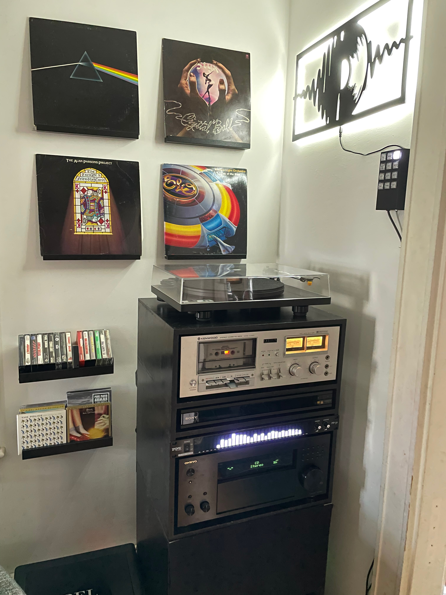
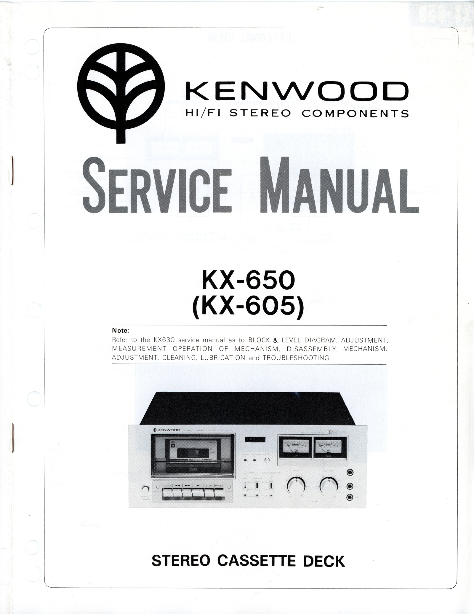
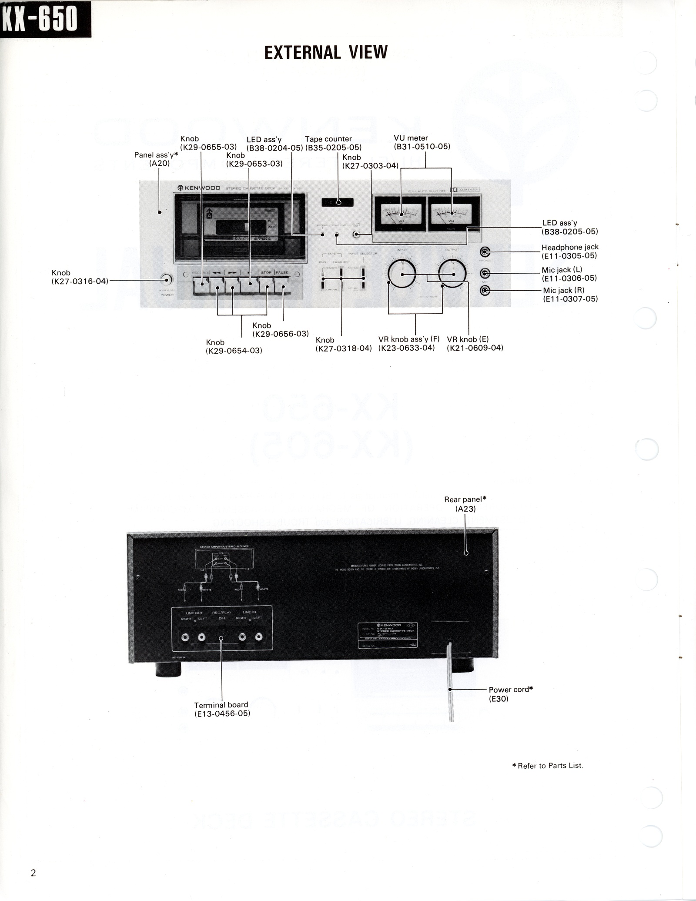
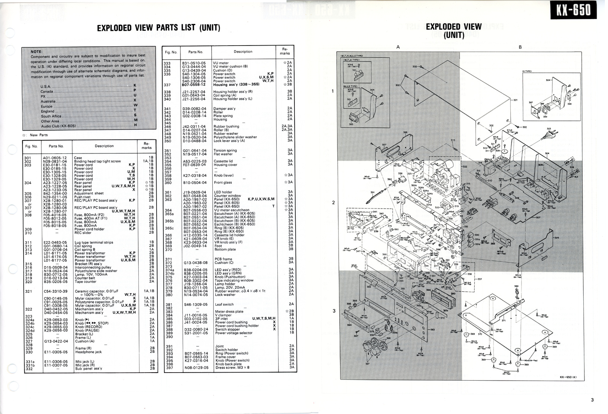
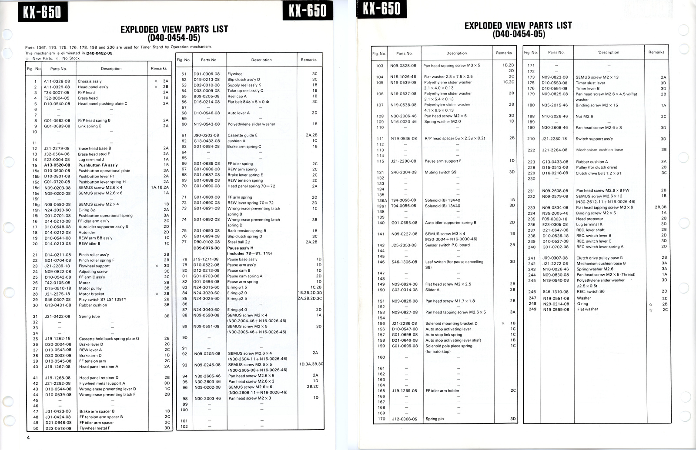
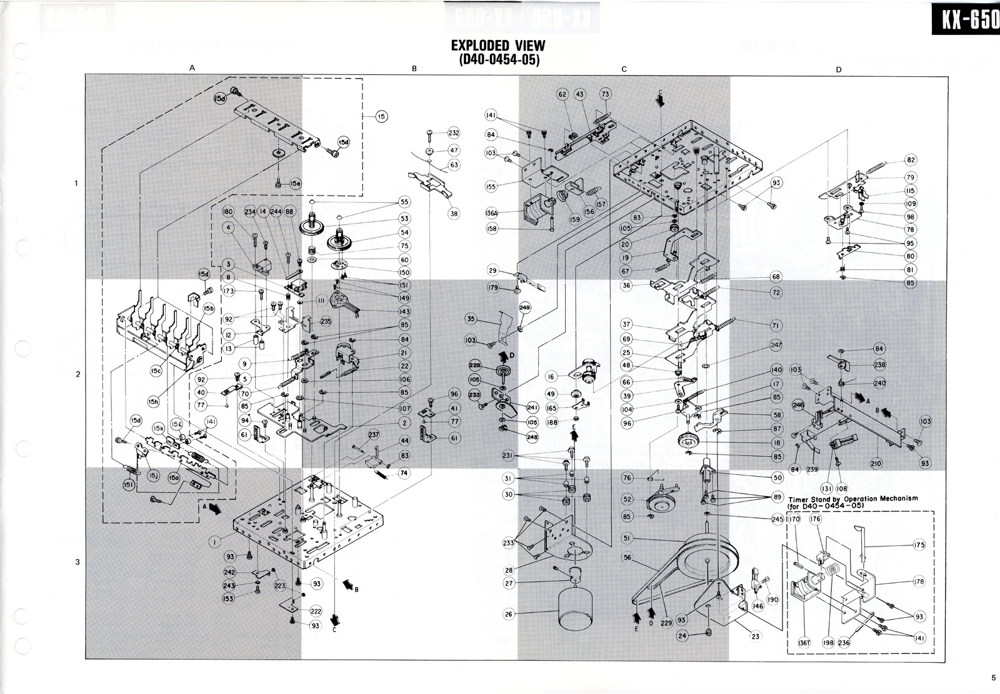
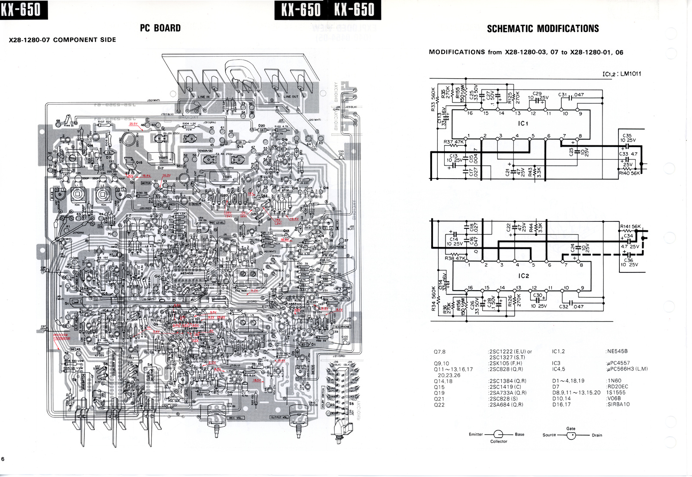
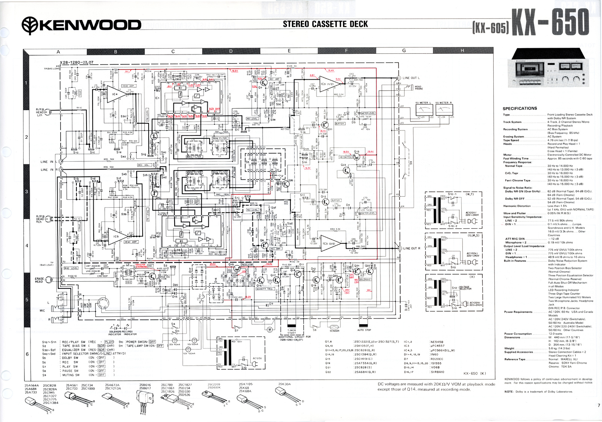
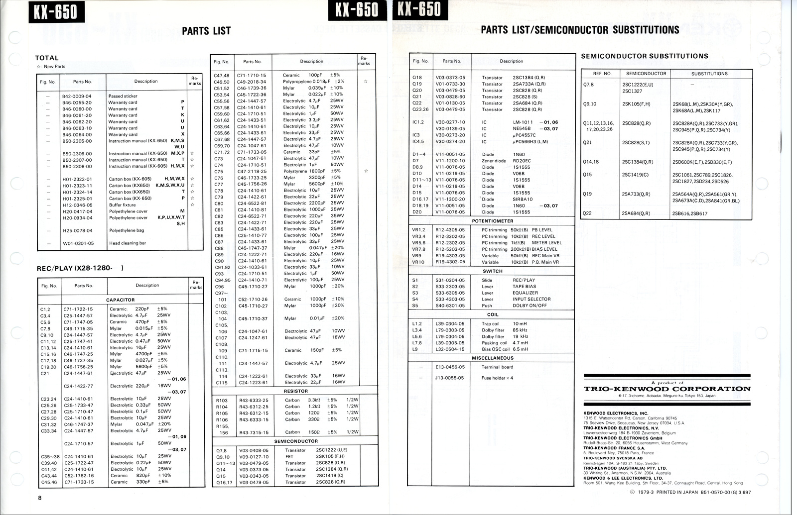

# Kenwood KX-650 Service Manual

I have a 1980s vintage cassette deck in my retro-modern stereo rack. Feel free to read more about my [stereo control hardware device](https://github.com/dgaff/onkyo-control) and learn a bit more about the audio stack. The cassette deck took some work to rehabilitate, and as part of that process, I had to find a service manual with a really good schematic. The images I found online weren't great, so I bought an old printed service manual on ebay from [VintageAudioStore.com](https://VintageAudioStore.com). Check them out if you're looking for old manuals. This repo contains thumbnails to the service manual. Click the thumbnails to get 1200dpi high resolution scans of the images. If you find this helpful, please consider supporting me.

## Manual Pages

